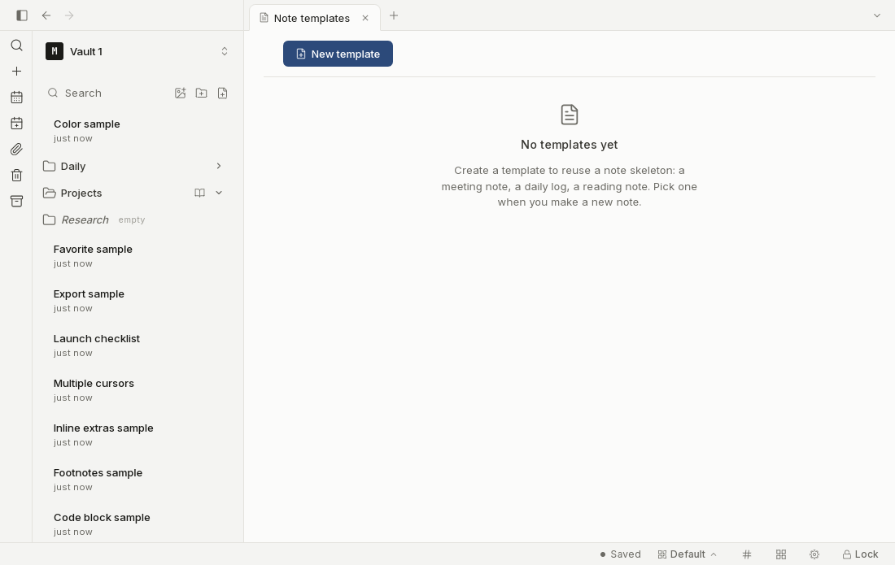

A template is a note you reuse as a starting point: a meeting structure, a daily layout, a checklist. Myne keeps templates simple and local: a template is just a note you have marked, and a small, fixed set of placeholders fill in things like today's date. This article covers making templates, managing them, and the placeholders.

## What a template is

A template is **an ordinary note** with a `template: true` marker in its frontmatter. There is nothing special about its storage; it is encrypted like any other note. Myne ships **no built-in templates**; you start with none and make the ones you want.

Notes in the Trash and notes marked as templates are hidden from the sidebar and never appear in search results.

## Creating and using a template

Making a note from a template is a deliberate, two-step path (distinct from the plain "new note", which is always an instant blank):

1. Choose **New note from template…** and pick the template you want, or **Blank note** to skip the template. If you have no templates yet, the same surface offers **Create a template**; **Manage templates** opens the manager from here too.
2. Give the new note a name. Myne copies the template's body into a fresh note, fills in any placeholders, and opens it.

You manage templates from the **Manage templates** surface, a dialog titled **Note templates**. It lists your templates, one per row, and offers four things:

- **New template** creates a fresh template and opens it to edit.
- **Clicking a row** opens that template so you can change it. There is no separate Edit button.
- **Remove from templates** turns a template back into an ordinary note. Non-destructive; the note and its content stay, it just stops being a template.
- **The trash icon** on a row sends that template to the Trash like any note (recoverable from there).

The last two are deliberately different: one demotes, the other deletes.

## Turning a note into a template

You do not have to start a template from scratch. Open the note, open the editor's **Note actions** menu, and choose **Turn into template**. The note becomes a template in place. Read the consequence before you do it: a template leaves the sidebar and stops appearing in search results, so the note will look as though it has gone. An undo toast appears right after, so you can put it back if that was not what you wanted.

The same menu shows **Convert to note** on a template, which demotes it again. Nothing about the note's content, title, or folder changes either way.

## Placeholders

When a note is created from a template, Myne fills in these seven placeholders, and only these seven:

| Placeholder | Becomes |
|---|---|
| `{{title}}` | the new note's title (used verbatim; may be empty) |
| `{{date}}` | today's date, as `YYYY-MM-DD`, in your local time |
| `{{time}}` | the current time, as `HH:mm`, 24-hour, local |
| `{{datetime}}` | the local date and time combined |
| `{{weekday}}` | the day's name, in the app's language |
| `{{period_start}}` | the first day of the period, as `YYYY-MM-DD` |
| `{{period_end}}` | the last day of the period, as `YYYY-MM-DD` |

The last two are for [periodic notes](/user-guide/notes-and-organization/periodic-notes/): in a weekly template they
give you the Monday and the Sunday, in a monthly one the first and the last day
of the month. They are filled in everywhere else too, where they both become
today, so a template never leaves an empty placeholder behind because you used
it from the wrong place. `{{date}}` always means today, even in a weekly note
you open on a Wednesday, so that one template file can be used both ways.

A few rules keep this predictable:

- **The list is closed.** These seven are the only placeholders. This is deliberate: there is no plugin system and no scripting; a template can only ever fill in this fixed set, never run code.
- **Anything else passes through unchanged.** An unknown name, a format-style `{{title:foo}}`, or an unbalanced run of braces is copied through exactly as written. That passthrough is also how you escape: to get a literal `{{date}}` in your output, you would write a name that isn't a placeholder.
- **Placeholders are matched once, left to right,** and names are case-sensitive; `{{Date}}` is not a placeholder.
- **Only inside templates.** In an ordinary note, `{{date}}` is just literal text; placeholders fill in only when a note is created from a template.

## Limits

Placeholders fill in once, at creation; they are not live and do not update afterward. The set is fixed by design; if you need richer structure, build it into the template body as plain markdown.
