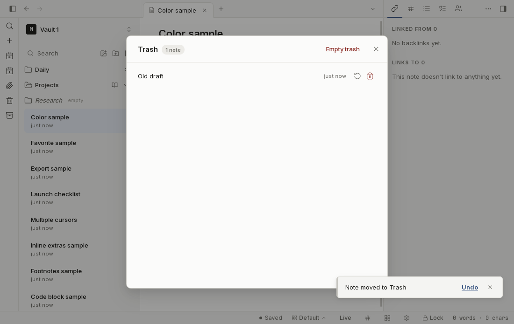

Deleting a note in Myne is a two-stage process: first it goes to the Trash, where you can get it back, and only emptying the Trash removes it for good. This article covers both stages and what "for good" actually means.

## Deleting a note

When you delete a note, it moves to the **Trash** and disappears from the sidebar. An **undo** toast appears immediately so you can put it straight back if you didn't mean it. The toast clears itself after a few seconds — it pauses while your pointer is over it, and it has a dismiss × — and once it is gone the note is still in the Trash, so **Restore** there does the same job.

If the note is open, its tabs close in every pane. Restoring it is an explicit step; it does not reopen on its own.

Deleting a folder that still contains notes asks you to confirm first, then moves the whole subtree to the Trash together.

Every one of these confirmations opens with the focus ring already on the button that goes ahead, so Enter confirms and Escape backs out. If you would rather click, the buttons work the way they look. And if you have moved the ring to **Cancel** with Tab, Enter cancels: the key always does what the button under the ring says.

Notes in the Trash and notes marked as templates are hidden from the sidebar and never appear in search results.

## Getting a note back

Open the Trash to see what's in it; each note is listed with how long ago it was trashed. **Restore** returns a note to the folder it came from, exactly where it was. Nothing in the Trash expires on its own: notes stay there until you remove them yourself. That is deliberate: the Trash is a safety net you control, not a timer.

## Trash versus Archive

The Trash is no longer the only way to set a note aside. [Archiving](/user-guide/notes-and-organization/archive/) is the other: it hides a note from the sidebar without putting it on the path to deletion. The two differ in what they do to a note:

- **Trash** hides the note from the sidebar *and* from search, and a trashed note does not resolve as a wikilink target. Trash is the route to permanent deletion: a single note removed from the Trash, or **Empty trash**, erases it for good.
- **Archive** hides the note from the sidebar but keeps it in search results and resolvable as a wikilink target. Archive has no automatic purge and no equivalent of **Empty trash** — nothing in the Archive is ever on a path to deletion.

A note holds at most one of these markers at a time: archiving a note clears its trashed marker, and trashing an archived note clears its archived marker. So a note is either live, archived, or in the Trash — never two at once.

## Permanent deletion

Removing a note from the Trash, the opposite of **Restore**, is the only irreversible step. You can delete a single note permanently, or use **Empty trash** to clear everything at once (Myne shows a count and asks you to confirm, because this cannot be undone).

These two dialogs confirm on Enter like the others, and they are the two where that is worth knowing: there is no undo behind them. When you reach one with the keyboard, it waits for you to let go of the key before Enter will confirm, so a key you were already holding cannot carry through into the answer. When you reach one with the mouse, the first Enter confirms. Either way it names the note, or the count, before you answer. Read the line, then press it.

When a note is permanently deleted, its encrypted file is removed, and with it the only on-disk copy of the key that note was encrypted under, so the content is not just unlinked, it becomes unrecoverable. The note's [snapshots](/user-guide/safety-and-recovery/note-snapshots/) are removed in the same step. After this, the recovery phrase cannot bring the note back, because there is nothing left to decrypt.

## Limits

Permanent deletion is final within the vault, but a [backup](/user-guide/safety-and-recovery/back-up-your-vault/) made *before* you deleted a note still contains it, and restoring that backup brings the note back. Deletion erases the live vault, not copies you have already exported. Plan deletions and backups with that in mind.
