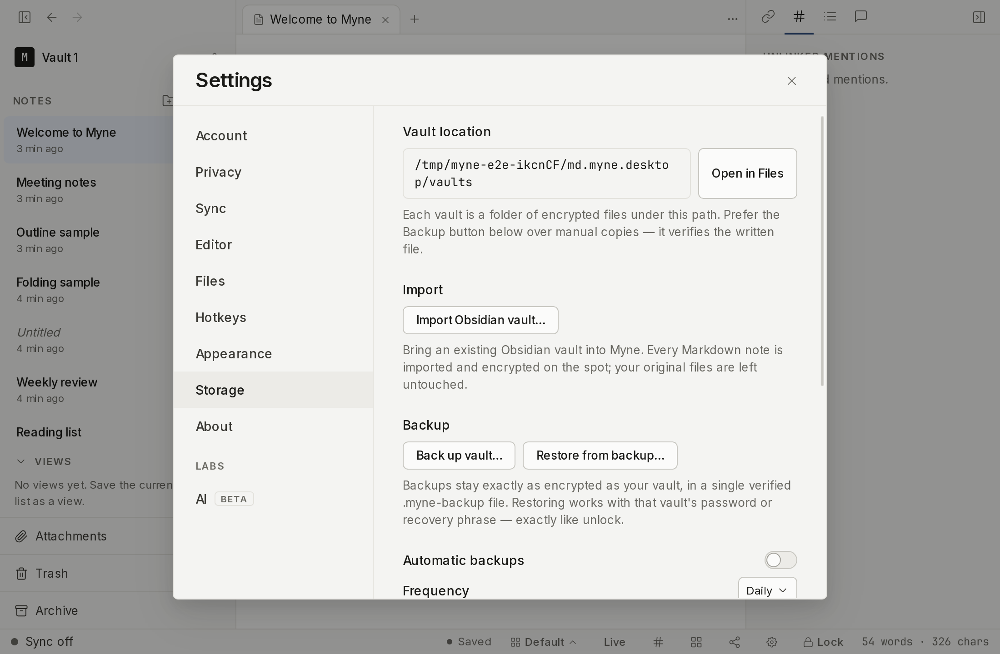

A backup is your protection against losing the vault files themselves: a disk dying, a laptop lost, a folder deleted by accident. Myne exports your vault as a single encrypted `.myne-backup` file that you keep somewhere safe. This article covers making one, what it contains, and the limits of what it protects.

## Making a backup

You can export a backup from three places:

- **Settings → Storage**.
- The **Back up vault…** command in the palette.
- The **Back up this vault now** button on the Ready screen, right after creating a vault.

All three are desktop app controls. The browser client cannot write a file to a place you keep, so backups are left out of it entirely rather than shown greyed out: there is no **Back up vault…** command there, and no backup block in **Settings → Storage**. A browser's local copy is a cache of a vault that lives on the sync server, and it re-downloads rather than restores. If you use Myne in a browser, make your backups on a computer.

Choose where to save the file. When the export finishes and Myne has checked it, you see **Backup verified and saved.** The file existing means it was written and verified. The file's name is one you choose; it is not tied to your vault's label.

## What's in the file

The backup is a **byte-for-byte copy** of your vault's encrypted files (your notes, their snapshots where the vault still takes them, attachments, and the vault's keys-as-stored) bundled into one file. Your settings, custom themes, personal dictionary and attachment catalog travel with it. What stays out is what Myne can rebuild, or what belongs to this device alone: the search index, the AI index, the layout caches and your quick-unlock PIN or Touch ID credential. The search index is rebuilt on first unlock, and quick unlock is set up again per device. Because the backup is the same encrypted bytes, it opens **with your password or your recovery phrase**, exactly like unlocking the vault: not with the phrase only, and not with anything Myne keeps.

A vault created on a current version of Myne is on Myne's newer format, and there each note carries its own edit history inside its encrypted file, so a backup of it contains every past revision of every note, including drafts you rewrote. The same becomes true of an older vault the moment you [upgrade its format](/user-guide/safety-and-recovery/upgrade-your-vault-format/). Nothing in the file is readable without your password or recovery phrase, but read the three points below with that in mind: a backup is a longer memory of your writing than a snapshot ever was.

The backup carries checksums, but they exist to **detect accidental corruption** (a truncated download, a bad sector) at export and restore time. They are not a tamper seal: they prove nothing about who made the file, and a backup is no safer "forever" than the place you keep it. What an onlooker can tell from the file is the same as from your vault folder, how many items it holds and their sizes, never your titles, content, or when you wrote them.

## What a backup does not protect you from

A backup is a copy frozen at the moment you made it, and that has three consequences worth understanding before you rely on one:

- An **old password opens old backups**. After you change your password, every backup taken before the change still opens with the old password.
- The **recovery phrase opens every backup of the vault, forever**. The phrase never changes, so it unlocks any backup you have ever made.
- **Restoring resurrects permanently-deleted notes**. A backup made before you deleted a note still contains it, so restoring that backup brings the note back.

On the newer vault format there is a fourth thing to weigh: a backup carries each note's past revisions, not only the note as it stood when you made the backup. The recovery phrase opens that history in any backup of the vault, for as long as the backup exists.

And the file itself is a new copy of your encrypted data living wherever you put it (a USB stick, a synced folder) outside Myne's sight. Treat a backup like a spare key to the vault, because that is what it is.

## A backup habit

You can let Myne keep the habit for you. **Settings → Storage** has an **Automatic backups** block: turn it on, pick a **frequency** (Every unlock, Daily, or Weekly), choose a **backup folder**, and set **Keep last** to how many backups to retain (7 by default). A **Last backup** line shows when the most recent automatic backup ran, or that none has yet. The manual **Back up vault…** control still works exactly as before, alongside the schedule.

How the schedule works, stated plainly:

- It runs **only while the app is open and the vault is unlocked**. There is no operating-system-level scheduling and no backup while the app is closed or the vault is locked. The check is an opportunistic elapsed-time one — Myne looks at whether enough time has passed when you unlock and roughly every five minutes while you keep working, so a missed window catches up on your next unlock rather than firing on a fixed clock. **Every unlock** means once per unlocked session: one backup per unlock, not one every few minutes.
- If the target folder is missing or can't be written, the **Last backup** line shows the failure plainly — it is never silent — and the schedule **stays on**. Myne does not quietly turn the schedule off, and it does not keep hammering a failing target either: after a failure it waits at least an hour, or a full cadence if your cadence is longer, before trying again. Fix the folder and the next attempt lands on that schedule.
- **Nothing is sent off your device.** There is no email and no cloud delivery; the schedule only writes a backup file to the folder you chose. If you want a copy offsite, point the folder at one your own file-sync handles, or copy the file yourself.

A few habits still worth keeping, scheduled or not:

- Back up **before you change your password**, on top of whatever the schedule does.
- **Occasionally test a restore**: bring a backup back with "Keep both" (see [Restore from a backup](/user-guide/safety-and-recovery/restore-from-a-backup/)) and confirm it opens, so you find a problem before you need the backup for real.
- **Store at least one copy on a different disk** than the vault, so one failure doesn't take both.

### How the schedule is stored

The schedule settings live in a small **plaintext file on this device** that records the target folder's path and a list of the backups Myne itself has written. That file is plaintext because it only holds a folder location and filenames — the backups it points at are the same encrypted bytes as your vault, so a known location reveals nothing about your notes. Because the settings are tied to a device-specific folder, they do not travel between devices: you set the schedule up once per device. The **Keep last** count prunes only the backup files Myne wrote on this schedule — a file you put in that folder yourself is never touched.

## Limits

A backup protects against losing your vault files; it does not protect against losing your credentials. That's what your [recovery phrase](/user-guide/getting-started/your-recovery-phrase/) is for. If you change your password, make a fresh backup and don't rely on the old ones being opened by a password you've moved on from.
