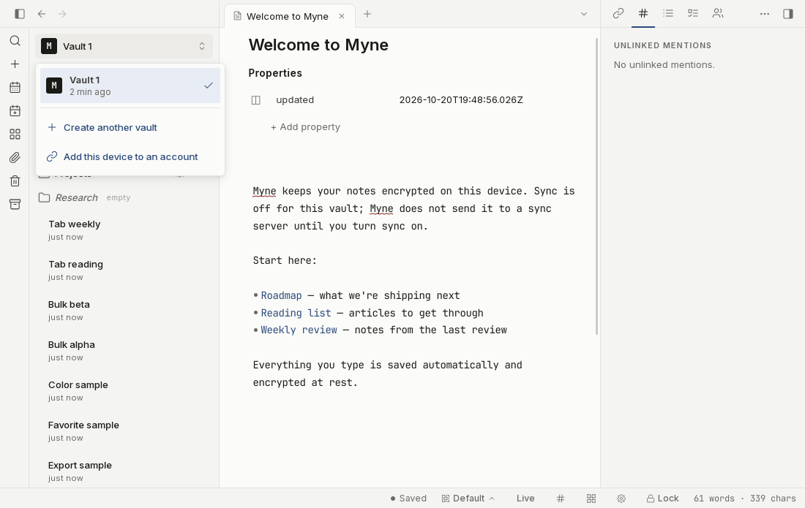

You can keep more than one vault, say one for work and one for personal notes. They are fully separate, and Myne keeps only one open at a time. This article covers switching, what's visible before you unlock, and how vaults stay independent.

## One vault open at a time

Myne unlocks one vault at a time. Switching to another means locking the current one and unlocking the next with its own password. There is no way to hop between vaults without unlocking, because each vault's key is only in memory while it is open.

When you have two or more vaults, Myne shows a **picker** at launch, and the vault-switcher chip at the top of the sidebar lets you switch while you work.

## What's visible before you unlock

Vaults you haven't unlocked are shown neutrally: a locked vault appears as **Vault 1**, **Vault 2**, and so on, not by a name that could reveal what's inside. Be aware of what *is* visible before any vault is unlocked: how many vaults you have, and when each was last opened. Their names, contents, and notes stay sealed until you unlock them.

## Naming a vault and giving it an icon

Each vault can carry its own name and icon, so the switcher tells them apart at a glance. Both show on the vault-switcher chip at the top of the sidebar and next to each vault in the switcher dropdown. A vault with no icon set shows a neutral **M** wordmark instead.

To set them, open **Settings → Account** while the vault is unlocked. The **Vault label** field names the vault; the **Icon** grid below it picks a glyph, and **Default (wordmark)** clears the icon back to the neutral mark.

Like the vault's contents, its name and icon live inside the vault's encrypted prefs. They only appear once you have unlocked that vault: a vault you have not unlocked this session shows the neutral mark and the neutral **Vault 1** / **Vault 2** placeholder described above. Nothing about the name or icon is visible before you unlock.

## Vaults are independent

Each vault is its own world: its own notes, folders, settings, recovery phrase, and backups. A backup is of one specific vault and restores only that vault. Changing your password in one vault does nothing to another. Nothing crosses between them.

## Managing the list

From the picker you can open an existing vault, **create another vault**, **restore from backup**, or **add this device to an account** you already sync (see [Add a device](/user-guide/sync-and-devices/add-a-device/)). The vault switcher in the sidebar carries the create and add-a-device entries too, so you can reach them without locking up first. Removing a vault from the list means **deleting** it: there is no "remove from the list but keep the files" option, and Myne doesn't pretend there is. Deleting a vault is permanent (see what that entails in [Delete a vault](/user-guide/settings-and-privacy/delete-a-vault/)).

## Limits

Because only one vault is open at a time, search, the graph, backlinks, and backups all act on the **current** vault only. There is no cross-vault search or linking.
