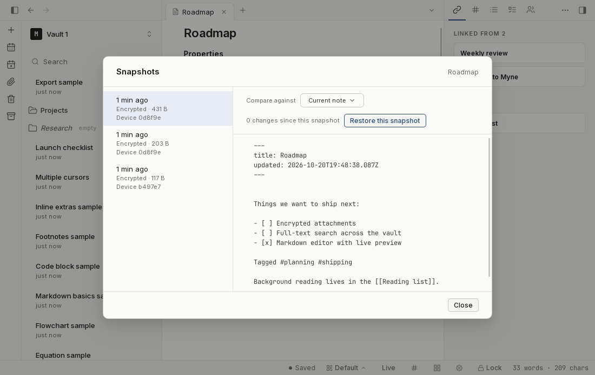

Snapshots are the original vault format's version history. In a vault on that format, Myne quietly keeps earlier versions of each note as you edit, so you can look back or roll back without thinking about it. A vault you create on a current version of Myne is already on the newer format and takes no snapshots at all (each note carries its own edit history inside itself instead), so its snapshots panel stays empty from the first note onward.

## Which vaults have snapshots

Snapshots belong to the original vault format. Two vaults never have them: one you create on a current version of Myne, which is born on the newer format, and one whose [format you have upgraded](/user-guide/safety-and-recovery/upgrade-your-vault-format/). In both, the snapshots panel shows its empty state and nothing is wrong. The rest of this article describes a vault still on the original format.

## How snapshots are taken

Myne takes a snapshot on its own; there is no save-version button. It groups your edits rather than capturing every keystroke: a snapshot is taken after a few minutes of changes, and when you close or lock the note. So a burst of typing becomes one snapshot, not a hundred.

Snapshots are kept for **about seven days**, then aged out. The panel's empty state says it plainly:

> No snapshots yet. Snapshots are saved automatically as you edit and kept for about 7 days. They're encrypted, and disappear when the note is permanently deleted.

Each snapshot is encrypted under the note's own key: a snapshot is as private as the note itself, and nothing more is claimed for it.

## Reviewing and restoring

Open the snapshots panel for a note to see its earlier versions. Pick one and Myne shows what changed as a diff. **Compare against** chooses what it is compared with: **Current note** answers "what would restoring this undo?", and **Previous snapshot** answers "what did this snapshot itself change?". The oldest snapshot has nothing before it, and says so. Restoring a snapshot is **always undoable**: before it rolls the note back, Myne takes a snapshot of the current version, so the state you restored *from* is itself in the history if you change your mind.

Each revision also shows who made it. On a vault that is not shared this is the **device** that wrote the change, by the name you gave it in [Managing devices](/user-guide/sync-and-devices/managing-devices/), or a short code for a device you have not named. On a shared vault it is the **person**, taken from the roster. A revision from before Myne recorded this shows **Unknown device**. The author reflects the device that wrote the revision: it is what the editing session reported, not a signature, so it attributes a revision for your reading and cannot prove anything about who really made it.

## What snapshots are not

Snapshots are a short-term undo for edits, not a deletion safety net. When a note is **permanently deleted, its snapshots go with it**: version history is part of the note, not a separate copy that outlives it. For protection across deletion, use the tools that are built for it:

- For a note you deleted, the [Trash](/user-guide/notes-and-organization/trash/) holds it until you empty it.
- For longer-term safety, a [backup](/user-guide/safety-and-recovery/back-up-your-vault/) made before the deletion still contains the note.

## After you upgrade the vault format

If you [upgrade the vault format](/user-guide/safety-and-recovery/upgrade-your-vault-format/), snapshots stop for that vault: no new ones are taken, and the existing ones move into the upgrade's old copy and are erased when you confirm the upgrade. From then on the snapshots panel browses each note's OWN edit history instead, which is also what a vault created on a current version of Myne has had from the start.

Two things about that history are worth knowing. It travels: it is part of the encrypted note, so it syncs to your other devices and is included in every backup, where an old snapshot never left the device that made it. And each revision now shows who made it (see above), which an old snapshot did not.

## Limits

Snapshots cover roughly the last week of a note's edits, live only inside the vault that holds the note, and are not exported on their own. They are not a substitute for a backup. All of that describes a vault on the original format. On the newer format (a vault you created on a current version of Myne, or one you upgraded) there are no snapshots: the note carries its own history, and that history syncs and is backed up with the note.
