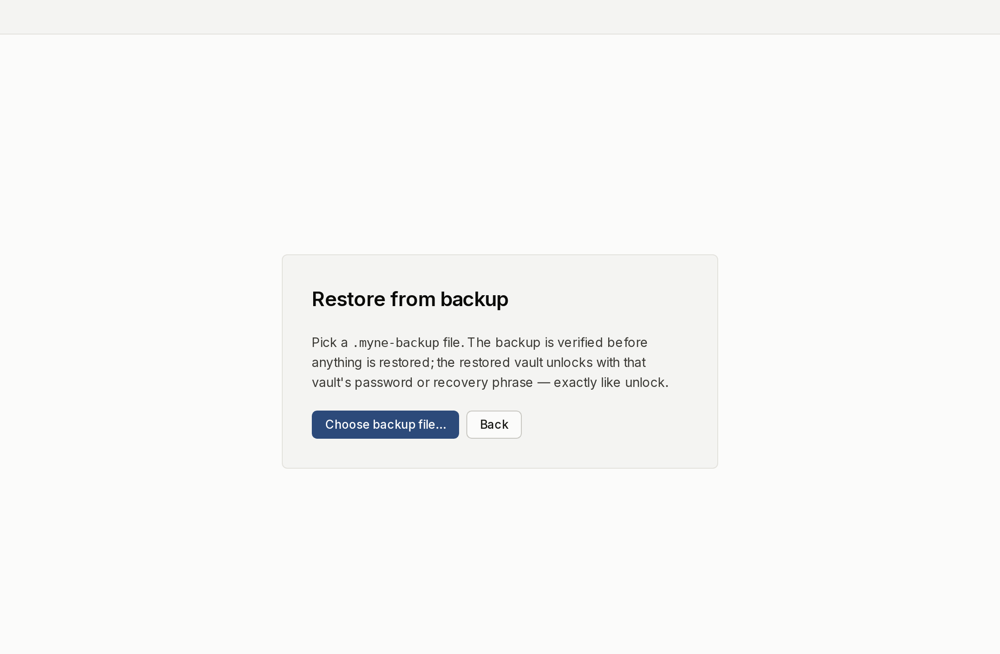

Restoring brings a vault back from a `.myne-backup` file, onto a new computer, or after the live vault is damaged. This article covers the flow, what happens if a matching vault already exists, and how a damaged backup is handled.

## Starting a restore

You can start a restore from four places: the **Restore from backup** door on the Welcome screen, **Settings → Storage**, the command palette, and the corrupted-vault screen. They all lead to the same flow: pick the `.myne-backup` file, and Myne rebuilds the vault from it.

Restoring does not ask for your password, because the backup is encrypted bytes and copying them back needs no key. The restored vault arrives **locked**; you open it afterward with its password or recovery phrase, the same as any vault.

## When a matching vault already exists

If the backup is of a vault you still have, Myne asks how to handle the overlap. You have two choices:

- **Keep both**: the restored copy comes in as a **separate vault** alongside your existing one. Nothing you have is touched. This is the safe choice.
- **Restore, then replace**: bring the backup in, then remove the existing vault. Myne does this in a safe order: it restores the backup to a separate vault **first**, and only then removes the old one, asking you to type DELETE to confirm that removal. It is never an in-place overwrite.

**If you're not sure, choose Keep both.** You can always delete the extra vault later; you cannot undo a replacement.

## If the backup is damaged

By default a restore is all-or-nothing: if the backup file is damaged, the restore stops cleanly rather than producing half a vault. If you would rather recover what can still be read, there is an explicit **salvage** option. Salvage always produces a **partial** vault (it recovers the notes it can and skips the rest) and it needs the backup's core vault information to be intact to run at all. Reach for it only when an all-or-nothing restore won't complete and a partial recovery is better than none.

## The restore summary

When the restore finishes, Myne reports what came back, including the number of **version history entries** recovered (a note's snapshots travel inside the backup). Review it to confirm the vault looks complete before you rely on it.

## When your live vault is corrupted

If Myne can't open your current vault because its files are damaged, it shows a screen with two ways forward: restore from a backup, or delete the vault and start over. The screen makes one promise explicit, **your current vault is not touched: the backup is restored as a separate vault first**, so trying a restore can't make a bad situation worse. If the restore works, you have your notes back in a fresh vault; if you have no backup, the start-over path clears the unreadable vault so you can begin again.

## Limits

A restore is only as recent as the backup you restore from; anything written after that backup was made is not in it. "Restore" here always means from a backup; if you've forgotten your password, that's [unlocking with your recovery phrase](/user-guide/safety-and-recovery/if-you-forget-your-password/), a different thing.
