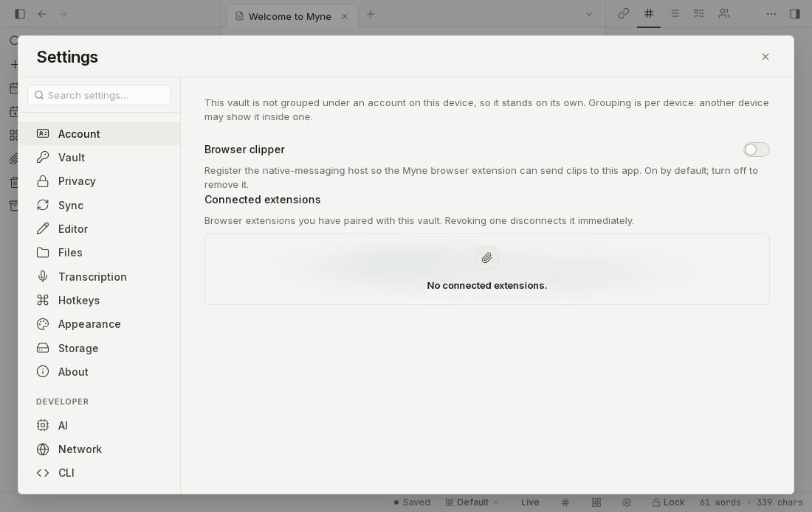

The **Account** panel is the account-level surface: it names the account this device groups vaults under, lists the vaults in that group, and holds the browser-extension pairing controls. It sits first in the settings rail. Your account number is not shown here, but it is the identity you use to add another device.

## Prerequisites

- A vault open. Settings is only available once a vault is unlocked.

Open Settings from the gear in the bottom bar or with `⌘,`, then choose **Account** in the left rail. It is the first panel and the one selected by default.

On a phone, the vault-scoped controls live in a **Vault** category of their own rather than in Account: the vault's name and icon, **Change password**, and quick unlock. Account keeps the **Delete vault…** action, so the irreversible erase stays separate from the controls you open this panel to change. The names are the same on both, so **Vault** and **Account** mean the same two groups whichever device you are on.

## What's in the panel

- **Account name**: the name you gave the set of vaults this device treats as one identity, with an inline rename beside it. It is a per-device organisational choice kept in the device-local record, so it never syncs — renaming the account here does not rename it on another device, and each device can group its vaults under a different account name.
- **Vaults**: the vaults currently grouped under this account on this device, with a count. The same set appears in the vault picker before you unlock; switching, adding and removing vaults is covered in [Working with multiple vaults](/user-guide/safety-and-recovery/multiple-vaults/).
- **A pointer to Sync**: devices, the members of a shared vault, and your person identity are account-shaped, but they live in the Sync panel, so the panel says where they are rather than repeating them. See the [Sync and devices](/user-guide/sync-and-devices/overview/) section.
- **Browser clipper**: a switch that registers the native-messaging host the Myne browser extension talks to. It is on by default; turning it off removes the host, so no extension can reach this app until you turn it back on. See [Browser clipper](/user-guide/attachments-and-import/browser-clipper/).
- **Connected extensions**: the browser extensions currently paired with this vault, with a per-row Revoke. A revoked extension has to pair again before it can send clips.

The account name and the vault's own name are two different things, and the split is deliberate: the **account** is the device-local grouping of vaults, while the **vault** is the sealed container itself, whose label and icon live in the [Vault panel](/user-guide/settings-and-privacy/vault/). A vault keeps its label wherever it goes; an account name describes this device's own arrangement of them.

In a browser the panel is shorter: browser extensions do not pair with a browser tab, so the clipper switch and the extension list are absent there, and the account name and vault list are what remain.

## Your account number

Your account number is your account's primary identifier, generated when you created the vault in place of an email address. It is a `MY-` prefixed string of Crockford base32 groups.

It matters in two places:

- **Adding a device.** To add another device to the same account, you enter your account number together with your master password or your 24-word recovery phrase. See the [Sync and devices](/user-guide/sync-and-devices/overview/) section.
- **Self-hosting.** It is the value a self-host operator would use to identify your account on their server.

Myne shows your account number once, during vault creation, and prompts you to save it. It is not re-displayed in this panel, so keep the copy you saved when you set up the vault. See [Create your vault](/user-guide/getting-started/create-your-vault/).

## Limits

Your account name is local to this device and carries no security meaning: it is a label you chose, not an identifier anything authenticates against, and losing it costs nothing. Your account number is the identifier that matters, and it identifies your account, and, for sync, is the bearer credential the server checks; the server stores only a hash of it, never the number itself. It is not an encryption key: on its own it does not unlock or decrypt your vault — adding a device also requires your master password or your 24-word recovery phrase, and unlocking always requires one of those. Because the number carries secret entropy, treat it like your recovery phrase and keep it private. Anyone who has it can reach your account on a sync server, but they still cannot read your notes without your password or phrase. For the full model, see [How Myne protects your notes](/user-guide/settings-and-privacy/privacy-model/).
