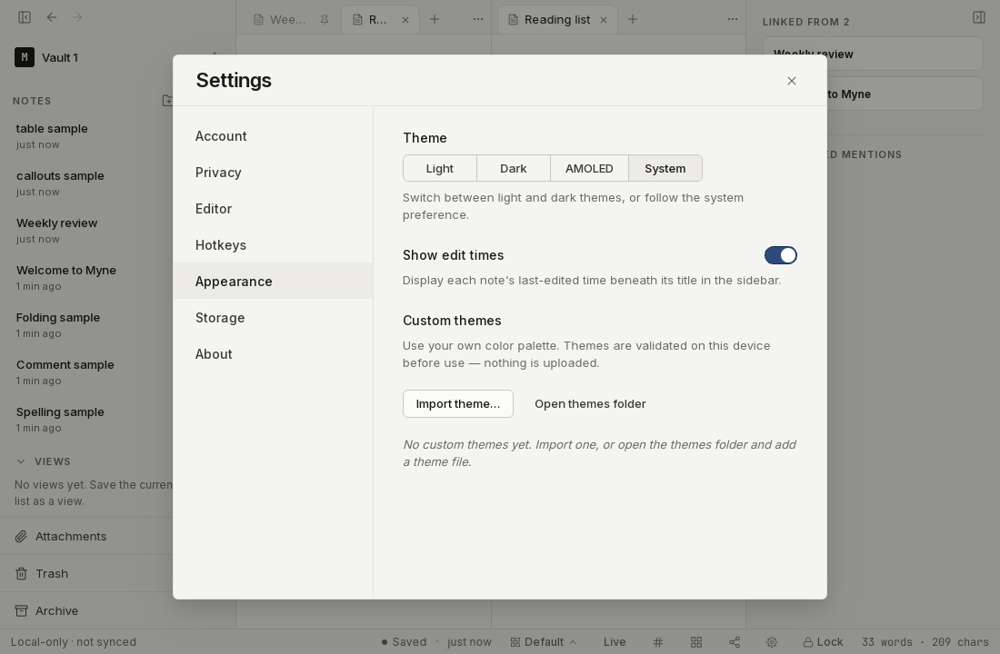

The Appearance panel controls how Myne looks. The main choice is the theme.

## Theme

Choose **Light**, **Dark**, or **System** (which follows your operating system's light/dark setting). Your choice is saved inside the vault's encrypted preferences. It stays on your device and is never sent anywhere or stored in any cloud.

One small privacy detail: while a vault is **locked**, Myne hasn't decrypted your preferences yet, so the app follows your operating system's appearance until you unlock. Your saved theme applies once the vault is open.

### Custom themes

A **Custom theme** lets you use your own color palette instead of the built-in Light or Dark. Open **Settings → Appearance → Custom themes**:

- **Open themes folder** reveals the folder where theme files live. The easiest way to start is to copy an existing theme, rename it, and edit the colors.
- **Import theme** picks a `.json` theme file and adds it to the list after checking it.
- Each theme shows a small color preview; **Apply** switches to it, and **Delete** removes it (with a confirm step).
- If a theme is rejected, the list shows why — a missing color, an invalid value and its line — so you can fix the file.

A custom theme replaces the Light / Dark / System choice while it is active, and it is checked on your device before use (nothing is uploaded). For the full file format — every color key and which value formats are allowed — see the [Custom theme reference](/user-guide/settings-and-privacy/custom-theme-reference/).

## What moved out of Appearance

Appearance now holds purely-visual controls. Note-authoring settings that used to live here have moved to the new **Editor** panel:

- **Daily notes** setup — the folder they go in and the date format for their titles — is now under **Settings → Editor**. What daily notes are and how to open today's note is covered in [Daily notes](/user-guide/notes-and-organization/daily-notes/).
- **Spell check** — the toggle and language picker — is also under **Settings → Editor**, described in [Spell check](/user-guide/editor-and-writing/spell-check/).

The Editor panel is also where the editor's typography presets live — text size, line spacing, content width, and the editor font. Those are covered in [Editor display](/user-guide/editor-and-writing/editor-display/).

## Limits

Appearance settings change presentation only, and never affect what is encrypted or what is stored. Like the rest of your preferences, they live in the encrypted vault, not in any external account.
