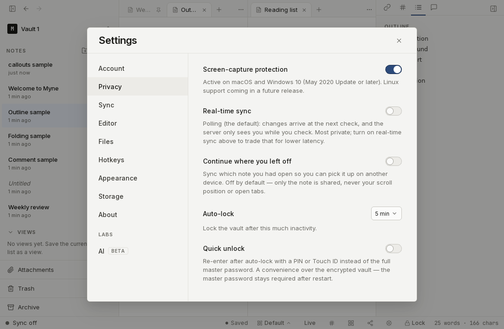

The Privacy panel has two controls that protect an open vault: auto-lock, which closes it after you step away, and screen-capture protection, which keeps other apps from recording the Myne window.

## Auto-lock

After a period of inactivity, Myne locks your vault on its own and returns you to the Unlock screen, flushing your work first. You choose how long: **1, 5, 15, 30, or 60 minutes**, and the default is **5**.

There is deliberately **no "Off"**. Auto-lock is an always-on protection. You can make the timer longer, but you cannot disable it, because an unlocked vault left open indefinitely is exactly the exposure this guards against. Inactivity is measured at the machine level (your whole computer being idle), not just the Myne window; on some Linux desktop setups the detection is stricter and may lock sooner.

What auto-lock does is **narrow the window** in which an unattended, unlocked vault sits exposed. It does not close it entirely. If someone reaches your device while the vault is still open, the timer hasn't fired yet; lock it yourself with the bottom-bar control when you walk away.

### Getting back in after a re-lock

When auto-lock fires it returns you to the Unlock screen, where your master password always reopens the vault. If you have set up [quick unlock](/user-guide/settings-and-privacy/quick-unlock/), a PIN field or a Touch ID button leads the screen, with the master-password form one **Use password instead** link away, so you can reverse the re-lock with a fast credential instead of retyping the full password. Quick unlock layers on top of the auto-lock-on-idle envelope; it does not change when the timer fires, only how quickly you get back in.

Two ceilings apply. Quick unlock allows **five consecutive failed attempts**; on the fifth, the stored credential is wiped and the vault falls back to the master password. And a configured **PIN** is unavailable on a **cold start** — after you quit and reopen Myne, the first unlock of the session always takes the full master password, after which the PIN option returns. A configured **Touch ID** credential is the exception: because macOS's own biometric prompt already guards it, it stays available on a cold start. The full details, including how the credential is stored, live in the [quick unlock](/user-guide/settings-and-privacy/quick-unlock/) article.

## Screen-capture protection

Screen-capture protection asks your operating system to keep the Myne window out of screenshots and screen recordings. It is applied before the window is first painted, and it is **on by default**.

You can toggle it in the Privacy panel, and the toggle governs what happens **after** you unlock: the Welcome and Unlock screens are always protected, whatever the setting says. The panel says so when the toggle is off — "Protection always applies before unlock. After unlock, follows this preference." Turning it off is what you do to take a screenshot of your own notes.

Be clear about its reach:

- It works on **macOS** and on **Windows 10 (the May 2020 Update, build 19041) and later**. It is not available on Linux.
- It uses the operating system's own content-protection feature, so it is only as strong as that feature, and it is **not anti-malware**. It stops a cooperating screen recorder from catching the window; it cannot stop software that has already compromised your machine from reading what's on screen.

## Limits

Both controls protect a vault that is unlocked and on screen. Neither protects the encrypted files at rest (your password does that) or a machine that is already compromised. Together they reduce the everyday ways an open vault leaks, such as a shoulder, a screen-share, or an unattended desk, but not every possible one.
