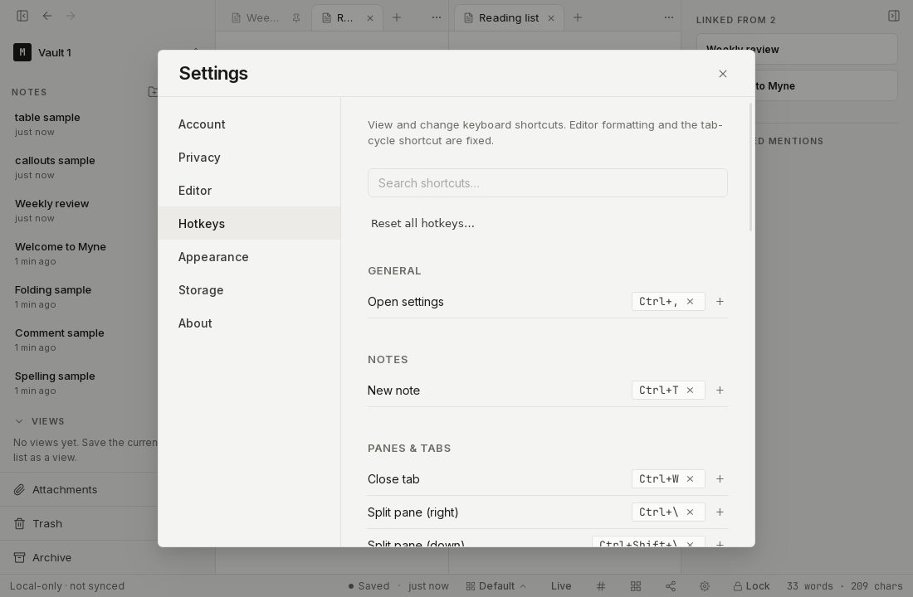

The Hotkeys panel lists every keyboard shortcut in Myne and lets you search them by name. You can add or remove a shortcut for most commands, restore a command's default, or reset every custom shortcut at once. If a key combination is already used by another command, Myne warns you and names that command, but it never blocks you — the new shortcut is assigned anyway.

## The Hotkeys panel

Open **Settings → Hotkeys** (the rail runs Account → Privacy → Editor → Hotkeys → Appearance → Storage → About). The panel opens with a short reminder at the top: "View and change keyboard shortcuts. Editor formatting and the tab-cycle shortcut are fixed."

Shortcuts are listed in groups: **General**, **Notes**, **Panes & Tabs**, **Navigation**, **View**, and **Editor formatting**. Each row names a command and shows its current shortcut as a small key chip. A command can have no shortcut, one, or several.

To find a command quickly, type into the **Search shortcuts…** box at the top. The list filters as you type, matching against the command name and its group.

## Adding and removing a shortcut

To add a shortcut to a command, click the **+** on its row and press the key combination you want. The captured combination is added to that command, so a single command can carry several shortcuts.

A combination has to include at least one modifier — **Cmd**, **Ctrl**, or **Alt** — or be a function key. A plain key on its own is rejected, with the message: "Add a modifier (⌘, Ctrl, or Alt) — a key on its own can't be a shortcut."

To remove a shortcut, click the **×** on its key chip. Removing a command's only shortcut leaves it with none until you add one back.

If you have changed a command, a **↺** appears on its row; click it to restore that one command to its default shortcut. To undo every change at once, click **Reset all hotkeys…** at the top. That asks first — "Reset every custom shortcut to its default?" — so a stray click won't wipe your shortcuts.

Your custom shortcuts are saved in the vault's encrypted preferences, so they stay set across restarts. Like the rest of your preferences, they live on your device.

## Conflicts

If you assign a combination that another command already uses, Myne shows a warning that names the other command — "Already used by <command> — added anyway." — and assigns the shortcut anyway. Conflicts are warning-only on purpose; the app tells you, but it never stops you mid-rebind.

Once two commands share a combination, both rows keep a small **⚠ conflict** marker so you can find and resolve them later if you want to. You resolve a conflict the same way you made it: remove the shared shortcut from one of the commands, or rebind one of them to something else.

## Fixed shortcuts

A few rows are shown for reference but cannot be changed; they are tagged **fixed**. These are the editor-formatting shortcuts (such as bold, italic, and the list toggles) and the tab-cycle shortcut, **Ctrl+Tab**, which cycles through open tabs. They appear in the panel so you can see what they do, but the **+**, **×**, and **↺** controls are not offered on those rows.

## Limits

Custom shortcuts only rebind commands that already exist. There is no plugin or scripting surface here: the keymap binds key combinations to Myne's built-in commands, and it can never introduce a new command or any custom behavior. A shortcut you set can change which keys trigger a command, or remove a command's shortcut entirely, but nothing more.

The keymap is stored as an ordinary field in your encrypted vault preferences, and it is not load-bearing for security. The worst a tampered or replayed value can do is rebind a shortcut or drop one — it cannot reach your notes or your keys. Many commands are also reachable from the command palette — Open settings, Show graph view, Toggle reading view, and Toggle focus mode among them — so removing their shortcut does not put them out of reach.

Conflicts are deliberately left as warnings rather than blocks. Myne names the colliding command and lets you decide; it does not decide for you.

## Shortcuts

These are the default shortcuts for the rebindable commands, plus the one fixed tab-cycle shortcut. You can change any of the rebindable ones in the Hotkeys panel.

| Action | macOS | Windows / Linux |
|---|---|---|
| Open settings | ⌘, | Ctrl , |
| New note | ⌘T | Ctrl T |
| Close tab | ⌘W | Ctrl W |
| Split pane (right) | ⌘\ | Ctrl \ |
| Split pane (down) | ⌘⇧\ | Ctrl Shift \ |
| Navigate back | ⌘[ | Ctrl [ |
| Navigate forward | ⌘] | Ctrl ] |
| Show graph view | ⌘⇧G | Ctrl Shift G |
| Toggle reading view | ⌘⇧E | Ctrl Shift E |
| Toggle focus mode | ⌘⇧F | Ctrl Shift F |
| Cycle tabs (fixed) | ⌃⇥ | Ctrl Tab |
