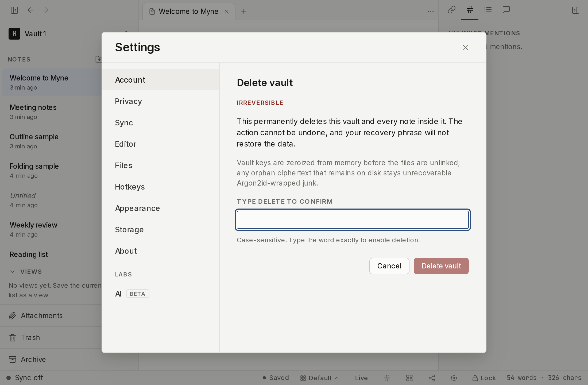

Deleting a vault removes it from your device for good. This is irreversible, so Myne makes you confirm deliberately. This article covers how it works and what "for good" really means.

## Deleting

From **Settings → Account**, choose Delete vault. To confirm, you type **DELETE**; there is no single-click delete, on purpose. When you confirm, Myne **wipes the vault's keys from memory first**, then removes its files. Wiping the keys before unlinking is what makes the deletion final: even the encrypted bytes left for an instant are unrecoverable without the keys, which are already gone. Deletion also clears any [quick-unlock](/user-guide/settings-and-privacy/quick-unlock/) you set up on this device — both the device-local quick-unlock file and the PIN wrap or macOS Keychain item the OS held for it. Deleting a vault is one of the things that invalidates its quick-unlock.

If some files can't be removed in the moment, such as a permissions or lock issue, Myne lets you continue, and any leftover unreadable fragments are handled by [Clean up leftover files](/user-guide/safety-and-recovery/leftover-files/).

## What deletion means

A deleted vault **cannot be undone**, and your **recovery phrase will not bring it back**. The phrase unlocks a vault; it does not recreate one that no longer exists on disk. Once the files are gone and the keys are wiped, there is nothing left to unlock.

One thing deletion does **not** reach: your backups. A `.myne-backup` you exported before deleting still contains the whole vault, and restoring it brings the vault back. Deleting the live vault does nothing to copies you have already made. That is the safety net if you delete something you shouldn't have, and the thing to remember if you meant the deletion to be complete.

## Limits

Deletion is about the **live** vault on this device. To be sure a vault is truly gone, account for any backups of it as well: delete those too, or keep them deliberately. Other vaults are untouched, and deleting one vault never affects another.
