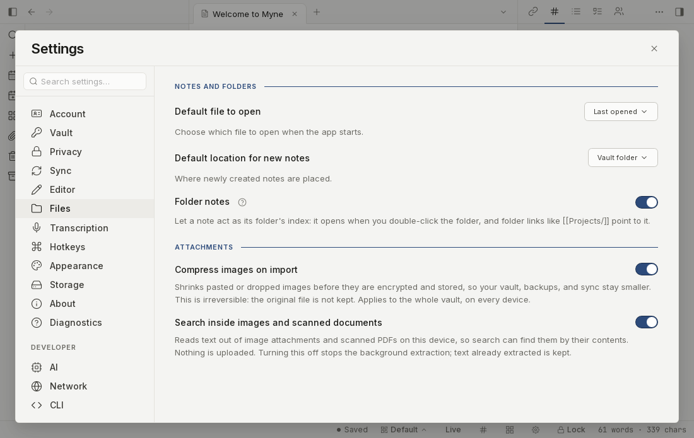

The Files panel holds five file-oriented preferences: which file opens when the app starts, where new notes are created, whether a note can act as its folder's index, whether images are compressed as you import them, and whether Myne reads text out of image and scanned-PDF attachments so search can find them. All five are stored in your vault's encrypted preferences and take effect the next time the relevant action happens.

## Prerequisites

- A vault open. Settings is only available once a vault is unlocked.

## Opening the Files panel

Open Settings from the gear in the bottom bar or with `⌘,`, then choose **Files** in the left rail. It sits after **Editor** and before **Transcription**.

## Default file to open

The **Default file to open** control decides what you see when the app starts. It offers three choices:

- **Last opened** reopens the note and layout you had when you last quit.
- **New note** starts a fresh, empty note.
- **Specific note** opens one note you pick. Choosing it reveals a **Note to open on startup** picker; search for and select the note.

Choosing **New note** or **Specific note** does not touch your saved workspace. Myne skips restoring the saved layout for that session but leaves it on disk, so switching the setting back to **Last opened** brings your panes back. If a specific note is later deleted or cannot be read, its pane shows a missing-note state rather than clearing the setting on a transient read miss.

## Default location for new notes

The **Default location for new notes** control decides where a newly created note is placed. It offers three choices:

- **Vault folder** places new notes at the top level of the vault.
- **Same folder as current note** places a new note beside the note you have open. When no note is selected, it falls back to the vault folder.
- **In the folder specified below** reveals a **Folder for new notes** control. Search your vault's folders and pick one, so the path is chosen rather than typed from memory. A vault with no folders yet gets a plain field instead: type a path such as `Inbox/`, and it becomes a folder when the first note lands there.

This is only the default. Creating a note through a folder's own "new note here" action always places it in that folder, regardless of this setting. See [Notes and folders](/user-guide/notes-and-organization/notes-and-folders/) for the sidebar actions that create notes.

## Folder notes

The **Folder notes** control decides whether a note can act as its folder's index, opened by double-clicking the folder row, and whether a link like `[[Projects/]]` resolves to it. It is **off by default**. With it off, the buttons and menu items that create a folder note are hidden and any note already carrying the flag shows as an ordinary note.

Turning it off changes nothing on disk: a note keeps its `folder_index: true` frontmatter either way, so switching the control back on restores exactly what was there. See [Folder notes](/user-guide/notes-and-organization/folder-notes/) for what a folder note is and how to use one.

## Compress images on import

The **Compress images on import** control decides whether an image you paste or drop into a note is downscaled and re-encoded before it is encrypted and stored. It is on by default, so a vault of screenshots stays smaller on disk, in backups, and over sync. The transform is irreversible: Myne does not keep the original file, so anything added while this is on cannot be restored to its full-resolution bytes later. This preference is shared across the vault, so turning it off applies to the whole vault. See [Attachments](/user-guide/attachments-and-import/attachments/) for how attachment files are stored.

## Search inside images and scanned documents

The **Search inside images and scanned documents** control decides whether Myne reads text out of image attachments and scanned PDFs so search can find them by their contents. It is on by default and runs on your device — nothing is uploaded. This is a device-local choice: turning it off here stops the background extraction and the extraction that runs when you import a file, but does not change the setting on your other devices. Text already extracted is kept, so turning it back on resumes rather than starts over. See [Search](/user-guide/find-and-connect/search/) for how attachment text is folded into search results.

On a phone, the same control sits in **Settings → Data**, beside the export action, because the phone app has no Files panel. It is device-local there too: the device that does the reading is the one that owns the switch, so turning it off on a phone stops that phone's extraction and leaves your computer's choice alone.

## Limits

All five settings are stored inside your vault's encrypted preferences. The startup-file and new-note-location controls change where notes land and which one opens on launch — not what is protected or how. Selecting **New note** or **Specific note** as the startup file never deletes or overwrites the multi-pane layout saved from your last **Last opened** session; that layout stays on disk untouched until you return to **Last opened**.

**Compress images on import** changes an attachment's size and fidelity, not its protection — the file is encrypted either way. The compression happens once, at import, and cannot be undone: Myne does not keep the original bytes.

Where new notes are created is one of the settings the AI can change for you. Ask in the AI Chat tab, as [Let the AI change your notes](/user-guide/ai/agent-runs/#changing-settings) describes, and approve the change on the review card.
