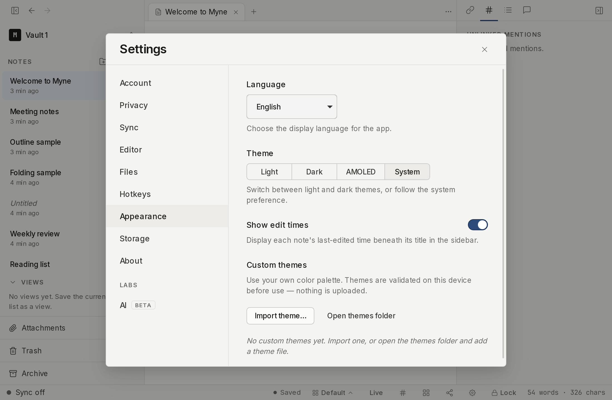

Myne's interface is available in 32 languages. The language selector lets you pick which one the app displays. It changes the app's own chrome — labels, menus, and dialogs — and leaves the contents of your notes exactly as you wrote them.

## Changing the interface language

1. Open Settings from the gear in the bottom bar or with `⌘,`.
2. Choose **Appearance** in the left rail. The **Language** selector is at the top of its **Display** tab.
3. Pick a language. The interface relabels immediately.

The translation catalogs ship with the app rather than arriving from a translation service, so no outside service ever sees your text or learns which language you read in. On the desktop app they are read from disk. In a browser, the catalog for the language you pick is loaded from the same address that served Myne, and from nowhere else. The choice is stored on this device and applies before you unlock a vault, so the Welcome and unlock screens are localized too.

Because the catalogs ship with the app rather than arriving afterwards, a string added to the interface recently can still appear in English in a language whose translation has not landed yet. It is a small number of strings at any time, and the rest of that language is unaffected.

## What it changes, and what it doesn't

- **Changes:** the application's own text — button labels, menus, settings, and dialogs.
- **Does not change:** the text inside your notes. Myne never translates or rewrites your content.
- **Right-to-left languages:** Arabic, Persian and Urdu are among the 32, and choosing one
  mirrors the whole interface — the sidebar, the navigation chevrons and the panel layout
  follow the language, with no separate setting to find. Note text keeps its own direction,
  so an English note stays left-to-right inside an Arabic interface.
- **Separate from spell check:** the spell-check dictionary has its own language setting in the **Editor** panel. See [Spell check](/user-guide/editor-and-writing/spell-check/).

## Limits

The language catalogs come from the build you already have, so changing languages reaches no third party. In a browser it fetches that language's catalog from Myne's own address, and nothing else. The setting is a device-local interface preference stored outside the encrypted vault (it has to work before you unlock), so it is not carried inside your notes and is not part of what your master password protects.
