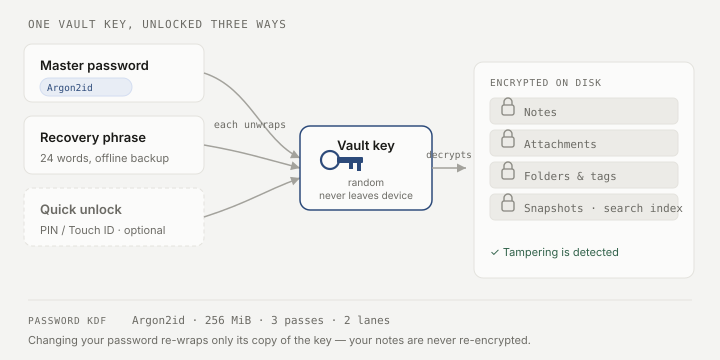
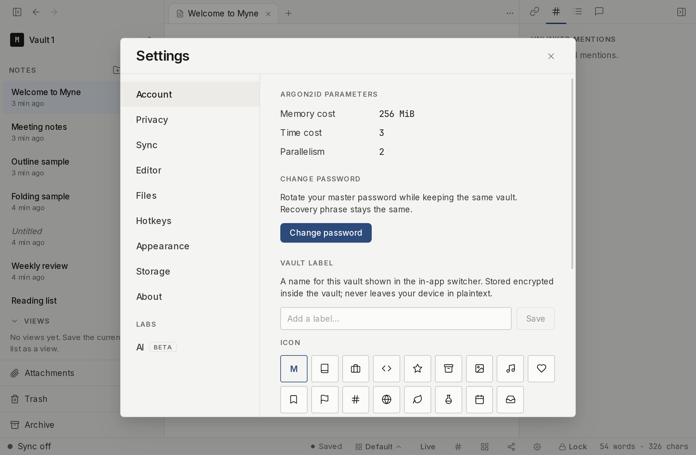

This is the article the rest of the guide points to when it says "private by design". It explains, plainly and then precisely, what Myne protects, how, and what it cannot protect you from.

## What is encrypted

Everything in your vault that holds meaning is encrypted on disk: your notes and their full text, your attachments, your folder structure, your tags, your note snapshots, your preferences, and the search index. None of it is readable without your key. What is *not* hidden is coarse structure: that a vault exists, roughly how many items it holds, and how big they are. The limits below cover this.

## How the encryption works

Your vault is protected by a single random key, generated when the vault is created and never sent anywhere. You never handle that key directly. Instead, separate credentials each unlock it:

- **Your master password**, run through a deliberately slow key-derivation function (Argon2id, tuned to use 256 MiB of memory, three passes, two lanes) so that guessing passwords is expensive.
- **Your 24-word recovery phrase**, an independent second key to the same vault.
- **Quick unlock (optional)**, a PIN or macOS Touch ID that stores a third encrypted copy of the vault's key in a device-local file. It is opt-in, never leaves the device, and is never part of a backup. The master password stays the primary credential — quick unlock only lets you re-enter after auto-lock, and the full password is still required after the app restarts. See [Quick unlock](/user-guide/settings-and-privacy/quick-unlock/).

Any one of these decrypts the vault's key, and with the key Myne decrypts your notes. Because each is an independent wrap of the same key, changing your password re-wraps only that one copy: your notes are never re-encrypted and your phrase keeps working. The encryption itself uses a modern authenticated cipher, so a tampered file is detected rather than silently accepted.

## Where your notes live

Myne today runs entirely on your device; nothing leaves it. There is no account on a server, no sync, no analytics, and no background connection. In this first version, Myne-the-company sees nothing: there is no server for your vault to talk to, and the app sends no telemetry.

There is also **no email at sign-up and no email recovery**. This is deliberate, not a missing feature. An email reset would mean someone other than you could trigger access to your vault, which is exactly the power Myne refuses to hold. The flip side is that *you* hold the only keys; the operational walkthrough for a forgotten password is [If you forget your password](/user-guide/safety-and-recovery/if-you-forget-your-password/).

## What we cannot protect you from

Encryption protects your notes at rest. It does not make the following go away, and it would be dishonest to imply otherwise:

- **Backups outlive deletions and password changes.** An old password opens old backups. The recovery phrase opens every backup of the vault, forever. Restoring resurrects permanently-deleted notes. A backup is a copy frozen in time, with all that implies. See [Back up your vault](/user-guide/safety-and-recovery/back-up-your-vault/).
- **Software running on your device can read an open vault.** While a vault is unlocked, its contents are decrypted in memory. Malware or another program with access to your running session can read what you can read; Myne's encryption guards the disk, not a compromised machine.
- **An unlocked vault on a grabbed device is open.** Auto-lock narrows the window in which an unattended, unlocked vault sits exposed, but if someone takes your device while you are using it, the vault is already open. Lock it yourself when you step away.

There is also coarse information a copy of your vault folder reveals even though the contents stay sealed: that the vault exists, how many vaults you have and when each was last opened, the sizes of the encrypted items, how often snapshots are taken, the key-derivation settings, and whether quick unlock is set up on this device (its small device-local file is present). Your titles, text, tags, folders, and the times you wrote are never among it. In particular: an attachment's name, contents, and type are encrypted; what a copy of the vault folder can still reveal is how many attachments there are and how big each one is.

If you use the PIN form of quick unlock, that device-local file is a third encrypted copy of the vault's key, and someone who copies it can try to guess the PIN offline. The only thing standing in the way is the PIN's length and the same deliberately slow key-derivation step — so the PIN path is weaker than the Touch ID path, which binds its copy to this device's hardware. See [Quick unlock](/user-guide/settings-and-privacy/quick-unlock/).

The full, precise catalogue of what Myne defends against and what it doesn't is in Myne's public threat model, and this article is the plain-language projection of it.

## Limits

This page describes the protection Myne provides today, in its first, fully-local version. Where a sibling article needs the technical detail (backups, the recovery flow, auto-lock) it links back here so the model is described in one place.
