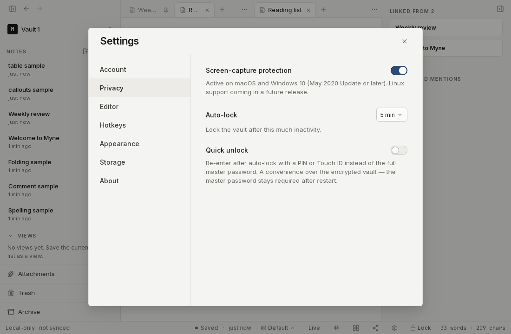

Quick unlock lets you re-enter a vault after it auto-locks with a short PIN, or with macOS Touch ID, instead of retyping the full master password. It is a convenience layered over the already-encrypted vault: it is device-local, off by default, and your master password is always still required after the app restarts. This article covers turning it on, using it, what wipes it, and where its limits are.

## Turning on quick unlock

Quick unlock is opt-in and off by default. You set it up per device, while the vault is unlocked, from **Settings → Privacy → Quick unlock**, the control below **Screen-capture protection** and **Auto-lock**.

The helper text under the toggle states the trade plainly: "Re-enter after auto-lock with a PIN or Touch ID instead of the full master password. A convenience over the encrypted vault — the master password stays required after restart."

Switch it on and a PIN field appears, with two buttons:

- **Set PIN** stores a PIN. The PIN must be **at least 6 digits and digits only** — the **Set PIN** button stays disabled until what you type meets that floor.
- **Use Touch ID** binds quick unlock to this Mac's Touch ID instead of a PIN.

A note next to those buttons is honest about which path is which: "Touch ID is macOS-only and currently experimental (pending hardware verification). PIN works everywhere." Treat the PIN as the path Myne stands behind today; see the limits below for what "experimental" means here.

Once configured, the panel shows a **Turn off** button. Turning it off wipes the quick-unlock credential from this device; you then unlock with your master password as before.

Each device opts in separately. The credential never syncs, and the Touch ID variant is bound to that one machine's hardware — it does not travel to another computer even if you later sync your vault.

## Re-entering after auto-lock

When [auto-lock](/user-guide/settings-and-privacy/auto-lock-and-screen-capture/) closes a vault during a running session and quick unlock is configured, the Unlock screen shows the quick-unlock affordance **above** the master-password form: a PIN field with **Unlock with PIN**, or an **Unlock with Touch ID** button.

The master-password form is always present below it, under the line "or use your password below". Quick unlock never replaces the password path — it sits in front of it, and you can always ignore it and type your password.

If a PIN is wrong, the screen tells you how many tries remain — "Incorrect. <N> attempt(s) left." — counting down toward the cap described next.

On a fresh app start, the quick-unlock affordance hides itself until one full master-password unlock has happened in this session. So after you launch the app cold, you simply use the password form; quick unlock becomes available only once the vault has been opened with the master password at least once that session.

## What invalidates quick unlock

Quick unlock is wiped, and you fall back to the master password, when any of these happen:

- You [change your master password](/user-guide/settings-and-privacy/change-your-password/).
- You [delete the vault](/user-guide/settings-and-privacy/delete-a-vault/).
- A PIN is entered wrong **5 times in a row**. After the fifth consecutive wrong attempt the credential is wiped — a successful unlock resets the count before then.
- For Touch ID, the enrolled set of fingerprints changes at the operating-system level.

After any of these, quick unlock is simply gone until you set it up again from Settings. Nothing about your vault, your notes, or your recovery phrase is affected — only the convenience credential on this device.

## Limits

Quick unlock is a convenience gate over a vault that is already encrypted. It does not change Myne's zero-knowledge root: your master password stays the primary credential, and the quick-unlock credential only wraps a third copy of the vault key. Turning quick unlock on does not weaken the encryption of your notes, and turning it off does not strengthen it.

It does not defend against software already running on your device. Like the rest of Myne's protection, it guards the encrypted files at rest, not a compromised machine; a program with access to your running session can read an unlocked vault regardless of how you re-entered it.

The PIN path has a specific, honest bound. The 5-attempt cap only limits an attacker typing at your keyboard. It does not limit an attacker who copies the PIN credential's file off your device: that copy can be guessed offline as fast as their hardware allows, bounded only by Argon2id's cost and the entropy of your PIN. A 6-digit PIN is short; choose a longer one if this matters to you, and do not treat the PIN as equivalent in strength to your master password.

The Touch ID path is experimental and hardware-unverified — its own setup note calls it "experimental (pending hardware verification)". It is offered so you can try it, not as a verified security boundary; until that verification lands, rely on the PIN as the path Myne stands behind, and on your master password as the credential that always works.

## Shortcuts

| Action | macOS | Windows / Linux |
|---|---|---|
| Open Settings | ⌘, | Ctrl , |
