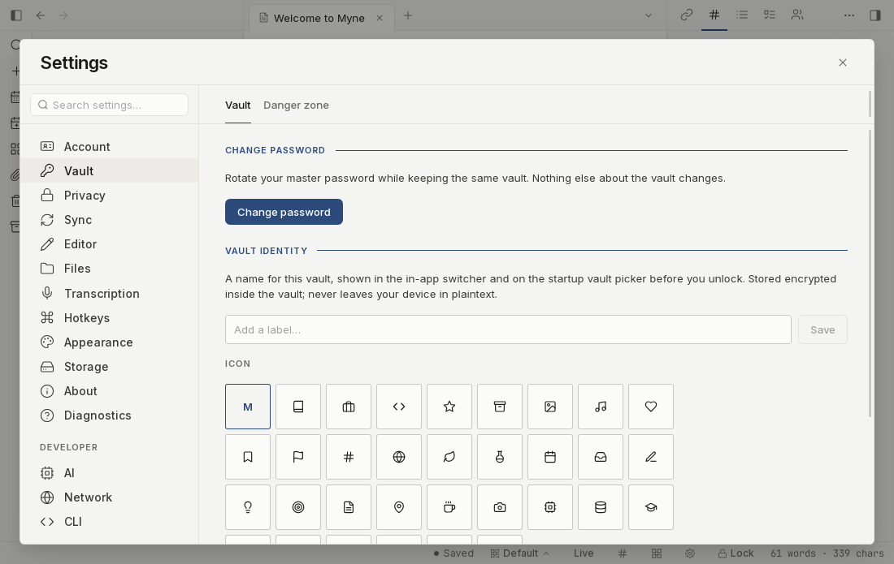

The **Vault** panel holds everything that acts on this vault as a container: the name and icon you give it, the password that opens it, and its deletion. It sits in the settings rail between **Account** and **Privacy**.

## Prerequisites

- A vault open. Settings is only available once a vault is unlocked.

Open Settings from the gear in the bottom bar or with `⌘,`, then choose **Vault** in the left rail.

## What's in the panel

- **Vault label and icon**: a name and glyph for this vault, shown in the in-app vault switcher and on the startup vault picker before you unlock. Both are stored encrypted inside the vault. See [Working with multiple vaults](/user-guide/safety-and-recovery/multiple-vaults/).
- **Change password**: rotate your master password while keeping the same vault. See [Change your password](/user-guide/settings-and-privacy/change-your-password/).
- **Danger zone**: the delete form itself, which asks you to type **DELETE**, covered below. There is no button in front of it: the trigger and the confirmation are the same step.

The vault label is also kept in a sealed device-local copy, so the locked vault picker can show this vault's name after a restart. Renaming updates that copy only on the device you rename from, and Myne says so under the field while the change is pending. Until you unlock the vault on your other devices, their lock screens keep showing whatever they stored last: an earlier name, or a placeholder if they never stored one. Clearing the label works the same way, so emptying the field here does not reach the copy sitting on another device's lock screen. See [Vault names on the lock screen](/user-guide/settings-and-privacy/vault-names-on-the-lock-screen/).

This is the vault's own name, not the account's. The account is the device-local set of vaults this device treats as one identity, and its name lives in the [Account panel](/user-guide/settings-and-privacy/account/); the two never sync the same way, and the vault's label is the one sealed inside the vault.

The panel does not show the key-derivation settings your password runs through. Myne stretches your master password with Argon2id (256 MiB of memory, three passes, two lanes) before it becomes your vault key, and that figure is shown when you create a vault. The model behind it is in [How Myne protects your notes](/user-guide/settings-and-privacy/privacy-model/).

## In a browser

In a browser the panel is shorter, and its last section makes a different promise. The browser client keeps your vault as a synced copy rather than as the only copy, so that section is headed **This browser** and its button reads **Sign out and erase this browser's copy…**. It removes Myne's copy from that browser and nothing else: your account and everything already synced stay on the server, and signing in again brings them back. The permanent, unrecoverable delete described below is the desktop and mobile action.

## Delete this vault

Deleting a vault is permanent and cannot be undone, and your recovery phrase will not bring it back. The full walkthrough, including exactly what is erased, is in [Delete a vault](/user-guide/settings-and-privacy/delete-a-vault/).

## Limits

The label and icon are part of the vault's encrypted content, so they travel with the vault and a backup carries them; the device-local copy that keeps the locked picker useful is the exception, and it lives on one device at a time.

Deletion is about the **live** vault on this device. To be sure a vault is truly gone, account for any [backups](/user-guide/safety-and-recovery/back-up-your-vault/) of it as well: delete those too, or keep them deliberately.

## Shortcuts

| Action | macOS | Windows / Linux |
|---|---|---|
| Open settings | ⌘, | Ctrl , |
