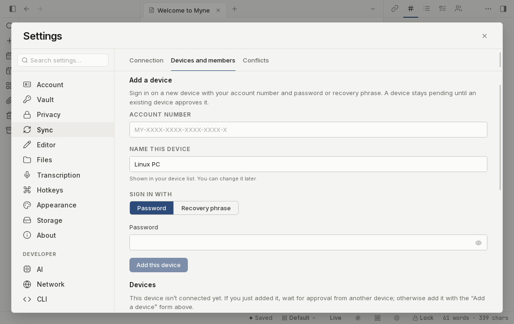

Adding a device connects it to your account so it syncs the same notes. A device you add with your password waits until a device that already has access approves it, and both devices then compare a short verification code to confirm they are on the same account. This page covers both ends of that flow.

## Prerequisites

- Sync already turned on for the account (see [Turn on sync](/user-guide/sync-and-devices/turn-on-sync/)).
- Your account number, and either your password or your 24-word recovery phrase.
- The sync server URL.

## On the new device

There are two starting points, depending on whether the device already has your vault:

- **A fresh device with no vault.** On the welcome screen, choose **Add this device to an account**. Enter the sync server URL, your account number, and your password. Myne fetches your encrypted vault from the server, unlocks it, and connects the device. This path does not need your recovery phrase.
- **A device that already has the vault.** Open **Settings → Sync**. If the device is not yet a member of the account, an **Add a device** section appears. Enter your account number, then sign in with either your **password** or your **recovery phrase** (a 24-cell grid — you can paste all 24 words at once to distribute them).

As you type your account number, Myne formats it for you (grouping and the `MY-` prefix), so you can type or paste it in whatever form you have it.

When you submit, the device connects and — for the password path — shows that it is **waiting for approval**. Keep that window open. The first device on an account, and any device added with the recovery phrase, self-approve and skip the wait.

## Pair with a QR code

Instead of typing your account number on the new device, a device that is already signed in to the account can show a QR code the new device scans. The QR fills in the sync server address and account number for you. It never carries your password or recovery phrase, so the new device still signs in with its own password and still goes through approval.

On a device that already has access:

1. Open **Settings → Sync** and find **Add a device with a QR**.
2. Paste your account number into the **Account number** field. Myne does not store your account number, so you supply it here from your own saved copy.
3. Choose **Make QR**. A QR code appears, labelled **Scan with the iOS app**.
4. On the new device, open the Myne app and scan the code. The sync server address and account number are filled in for you; enter that device's password to continue.

The code is short-lived and refreshes while the panel is open, so a photograph of it cannot be scanned later — the new device has to read it off this screen while both are in front of you. Once the new device signs in, it shows as awaiting approval, and the rest of the flow is the same as the manual path: approve it from a device that already has access, then compare the verification code.

## Approve it from an existing device

On a device that already has access:

1. Open **Settings → Sync** and find the new device under **Devices**, listed as awaiting approval.
2. Choose **Approve**.
3. Myne then shows a **verification code** for the new device. This is the out-of-band check: compare it against the code shown on the new device.
4. If the codes match, choose **They match**. If they do not, choose **They don't match**, which removes the device — a mismatch can mean the server tried to seat a device you did not add.

## Confirm on the new device

A device you joined from the welcome screen shows the same **verification code** once it is approved and finishes its first sync. Compare it with the code on the approving device:

- **They match — continue** finishes joining, and the device starts syncing.
- **They don't match — remove this device** stops the device trusting the synced data and undoes the join.

## Limits

The verification code is what protects a newly added device: a fresh device has no prior history to check against, so on its first sync it cannot detect a rolled-back or forked history on its own. Comparing the code out of band — reading it off both screens — is the step that closes that gap, which is why a mismatch removes the device rather than continuing. Adding a device with your recovery phrase self-approves and so skips the pending gate; that is a deliberate, accepted trade-off. Approving a device grants it ongoing sync access to your account's notes; if you later remove it, that revokes access going forward but does not reach back into what the device already holds (see [Managing devices](/user-guide/sync-and-devices/managing-devices/)). A QR code changes only how the new device receives the sync server address and account number — not what has to be verified. The code carries no password or recovery phrase, so the worst a tampered or swapped code can do is point the new device at the wrong account or server, which your password cannot unlock; a bad code fails the join rather than granting access. The new device still signs in with its own password, still waits for approval, and still compares the verification code. Scanning the code is done in the Myne app; today that scanner is the iOS app.
