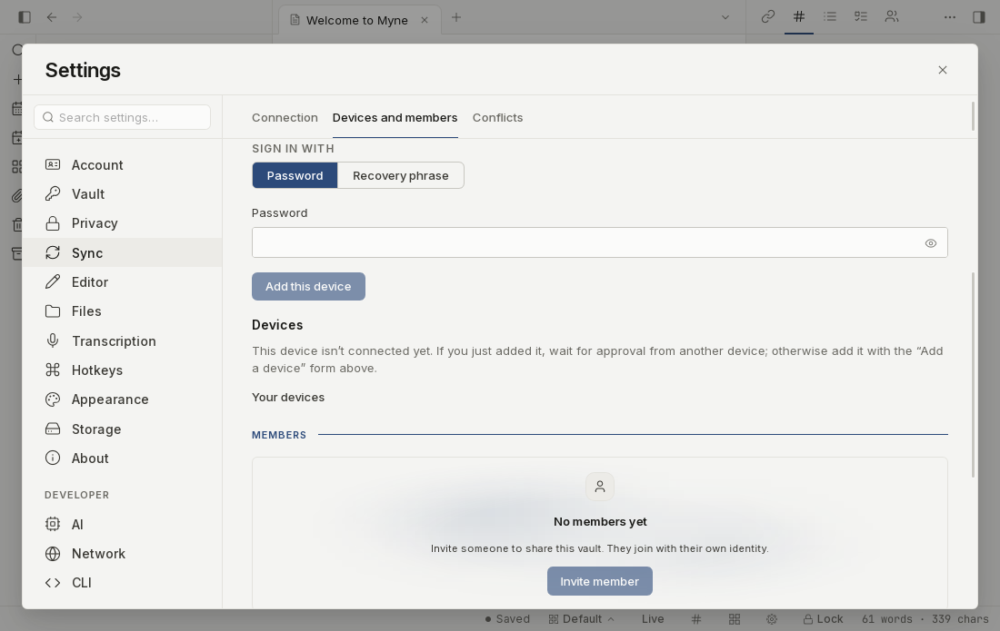

The **Devices** section of **Settings → Sync** lists the devices connected to your account and lets you approve pending ones or remove ones you no longer want syncing. Before removing a device, it is worth being precise about what removal does and does not do — the honest answer is narrower than "kick it off," and this page states it plainly.

## The device list

Under **Settings → Sync → Devices**, you see:

- **Your devices** — the approved devices on the account. The one you are using is marked **This device**. Each shows an editable name, which it was given when it was added; a device enrolled before names existed falls back to a short name derived from its identifier. The **Rename** action on a row turns the name into an editable field in place: Enter saves it, Esc cancels.
- **Awaiting approval** — devices that have connected with a password and are waiting for an existing device to approve them. Approving one starts the verification-code compare described in [Add a device](/user-guide/sync-and-devices/add-a-device/).

## Removing a device

Removing a device revokes its sync access: the server stops syncing to it. That is the whole of what removal does. It is **not** a remote wipe, and it does **not** lock a device that already has your vault and password — that device keeps whatever it already synced. Remove a device you no longer use to stop it receiving further updates, but do not treat removal as a way to reach into a lost or stolen device.

To remove a device, find it under **Your devices** and choose the **Remove** action on its row. Myne asks to confirm first — "Remove this device from sync?" — and restates what removal does before you commit: it revokes that device's sync access, so the server stops syncing to it, and it does not lock a device that already has your vault and password. Choose **Remove** to confirm, or **Cancel**. The device you are using shows no remove action against itself.

## When a device was removed elsewhere

If this device was removed from your account on another device, its sync will start being refused, and the Devices panel says so and offers **Reset and re-add this device**. Resetting clears this device's stale sync credentials so you can add it again from scratch.

## Recovered notes

When a note you deleted on another device is removed here to match, Myne keeps this device's encrypted copy under **Settings → Sync → Recovered notes** instead of discarding it, so a deletion that reached you by sync is not the last word. Each entry offers **Preview** to read it, **Restore** to bring it back as a new note, and **Delete** to remove it for good.

Deleting a recovered note is permanent. It is the only copy kept on this device, it does not go to Trash, and it cannot be undone — Myne says so in the confirmation before you commit.

## Resetting sync on this device

If sync is refused for a reason retrying cannot fix — a rejected credential, a frozen account, an account at its device limit, or a device stuck waiting for an approval that is not coming — the panel offers **Reset sync on this device**. A device waiting on an approval has no other way out: while the enrolment looks live, the **Add a device** form stays hidden, so resetting is what returns it to a state where it can be added again. This clears the device's local sync token and its sync baseline so it can be re-added. It never touches your notes and makes no changes on the server — it only resets this device's local sync state. If the trouble is instead that the server moved or its certificate changed, re-enter the server URL under **Sync server** to re-trust it rather than resetting.

## Limits

Removing a device is an availability control, not a cryptographic one. Because Myne's keys have no forward secrecy, revoking a device's sync token cannot cryptographically claw back the notes it already holds, and there is no remote wipe — a removed or compromised device retains whatever it synced before removal. If a device is lost and you are worried about its contents, rely on its own device lock and your vault's [auto-lock](/user-guide/settings-and-privacy/auto-lock-and-screen-capture/), and change your password if you believe your credentials are exposed. The at-rest strength of your vault does not depend on the sync token: the token authorises a device to sync, it does not wrap or unlock your notes.
