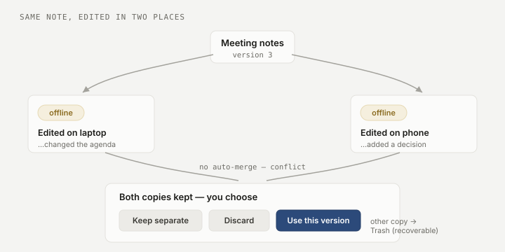

When the same note is edited on two devices before they have synced with each other, there is no single correct merge, so Myne keeps **both** copies rather than overwriting one. Nothing is silently lost. The extra copies are held out of your main note list and gathered in one place for you to reconcile.

## Finding conflicts

When conflicts exist, the [sync status](/user-guide/sync-and-devices/sync-status/) indicator reads **N conflicts to review**. Open **Settings → Sync → Conflicts** to see them. Conflicting copies are grouped under the note they diverged from, so you can tell which original each copy belongs to. Each copy shows three actions.

## Choosing what to keep

- **Keep as separate** turns the conflicting copy into an ordinary, standalone note. Use this when both versions are worth keeping — you end up with two notes and can merge them by hand later.
- **Discard** removes the conflicting copy. You keep the other side.
- **Use this version** promotes this copy to be the surviving note. This moves the *other* (local) version to Trash. Read the note below before using it.

## "Use this version" moves the other copy to Trash

Choosing **Use this version** makes the copy you picked the one note going forward and sends the previous local version to Trash. Right after, a short notice confirms "Local version moved to Trash." and offers **Undo**, which reverses the choice. If you miss the undo, the previous version is still recoverable from [Trash](/user-guide/notes-and-organization/trash/) until Trash is emptied.

## Limits

Myne's conflict handling is keep-both, not automatic merging: it never blends two edited versions of a note into one, because doing so could quietly corrupt your text. Resolving a conflict is a decision you make. **Discard** and **Use this version** both send a copy to Trash rather than erasing it immediately, so a mistake is recoverable — until you empty Trash, which is the point of no return. Conflicts are a normal consequence of editing offline on two devices; they are not a sign that anything was lost or that the server misbehaved. A genuine integrity problem is surfaced separately as an alert, described in [Reading sync status](/user-guide/sync-and-devices/sync-status/).
