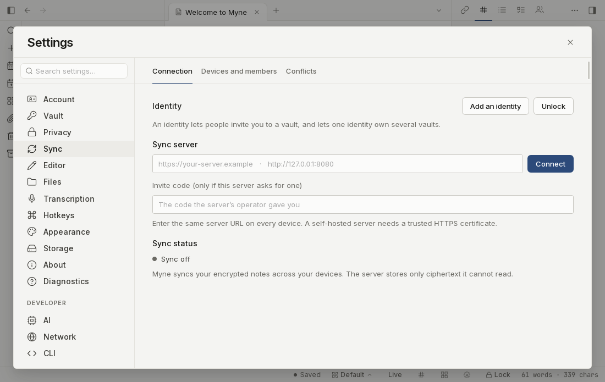

Sync surfaces its state in one place and a few banners. The status indicator in **Settings → Sync** tells you whether the device is synced, working, or needs attention; a small set of banners appear when something worth explaining happens. This page covers how to read each.

## The status indicator

Under **Settings → Sync → Sync status**, a coloured dot and a short label show the current state:

- **Sync off** — no server is configured. Nothing syncs.
- **Not enrolled** — a server is set, but this device is not yet a member of the account. Add it (see [Add a device](/user-guide/sync-and-devices/add-a-device/)).
- **Awaiting approval** — this device is connected but waiting for an existing device to approve it.
- **Synced** — this device is up to date.
- **Syncing…** — a sync is in progress.
- **Sync error** — the last sync did not complete, for a reason Myne could not name.
- **N conflicts to review** — the same note was edited on two devices; resolve them in [Resolving conflicts](/user-guide/sync-and-devices/resolving-conflicts/).

Where Myne can name the reason a sync failed, it does so instead of showing the generic error, because each one has a different remedy:

- **Sync sign-in expired** — this device's access was rejected. Add it again from **Devices**.
- **Sync throttled: retrying**. The server is rate-limiting this account. There is nothing to do; the next attempt is spaced out.
- **Storage full: uploads paused**, **A file is too large to upload** and **Account frozen: uploads paused**. These are the three states covered in [Storage and account limits](/user-guide/sync-and-devices/storage-and-limits/).
- **Storage full: syncing paused**. This device's own disk is full, not your account's ceiling. Free space on the machine.
- **This device was removed from your account** — someone removed it from another device; see [Managing devices](/user-guide/sync-and-devices/managing-devices/).
- **Couldn't verify the sync server's HTTPS connection** — the server's certificate did not pass the check against the public certificate authorities. Verify the address and that the certificate is valid; see below.

A **Sync now** button triggers an immediate sync. It is hidden when there is nothing to trigger — when sync is off, when the device is not enrolled, or while it is awaiting approval.

## The server's certificate could not be verified

Myne checks the server's certificate against the public certificate authorities and checks the server name on every connection. If that check fails, sync stops with **Couldn't verify the sync server's HTTPS connection**, and Myne will reconnect once the server presents a certificate that passes.

This is not the "the server didn't answer" case. The server answered; what it presented could not be checked. The remedy is about the server: check that the address is right and that its certificate is valid. The panel says as much: "Couldn't verify the server's HTTPS certificate. Check the server address, certificate and its validity."

A renewed certificate with a valid replacement passes the check and needs nothing from you. There is no fingerprint to compare and no re-enter-the-URL step. [Server certificates](/user-guide/sync-and-devices/server-certificates/) covers what the check does and does not prove.

## Per-note status, in the sidebar and the bottom bar

The status row above is about the device. It says nothing about any one note, and the two can disagree in exactly the case that matters: a device sitting happily at **Synced** can still be holding a note the server has never seen, because the last cycle failed or the machine was offline when you wrote it.

So each note carries its own small mark, in the sidebar row and again beside the save readout at the bottom of the editor, and both use the same three shapes:

- a **filled dot** means settled. Nothing is owed for that note.
- an **arc with a gap in it, standing still**, means something is outstanding. The note is not on the server yet, or what you just typed is not written to disk yet. An arc that is not moving is not a problem; it is the ordinary state of a note you are working on, and of every note on a laptop that is offline.
- the **same arc, turning**, means it is happening right now. A save being written, or a push in flight.

The distinction is deliberate. A mark that spun the whole time a note was unsynced would spin for days on a machine with no connection, and a spinner that never stops stops meaning anything. The arc turns only while Myne is actually doing something.

Hover either mark for the longer sentence.

## The catching-up notice

If a device has been offline for a while, its next sync may do a fuller reconcile to catch up. During that, a reassuring, dismissable banner appears: it says the device was offline for a while and is catching up, and that your notes are safe. It is informational, does not block the editor, and never implies data loss.

## When sync has been failing for days

A sync failure lasting four seconds and one lasting four days look identical in the status indicator, and the indicator lives in Settings, which you have no reason to open while your notes are saving normally. So once about three days have passed with no successful sync, a banner appears in the editor: "Myne hasn’t reached the sync server in several days. Your notes are saving on this device, but nothing has left it, so this is the only copy. Open Settings → Sync to see why."

It names no date and no elapsed time, because it answers a threshold rather than keeping a record of when you last synced. **Dismiss** hides it for the outage in front of you, and it re-arms once sync works again, so a dismissal does not cover the next one. A device that has never synced does not get it, because a device part-way through setup is not stale.

## The first-sync download notice

When a device pulls a vault for the first time, a notice counts the notes as they arrive: "Downloading your notes: 40 of 900". It is a count rather than a percentage or an estimate, because how long the rest takes depends on the machine and the connection. You can start working while it runs; the remaining notes appear as they land.

## The vault was upgraded elsewhere

If the vault's format was [upgraded](/user-guide/safety-and-recovery/upgrade-your-vault-format/) on another device, this device locks at the end of its next sync and says so: the keys changed, so the session has to unlock again. Nothing was lost. Unlock as usual to carry on.

## Myne can't tell which password is newer

If your password appears to have changed both on this device and on another, Myne stops rather than guessing, and says so. It changes nothing on either side. Sign in on a device that already has access to settle which password is current. This notice cannot be dismissed, because the condition does not clear on its own.

## Building the search index

After a full reconcile or a fresh device enrolment, Myne rebuilds the device's local [search](/user-guide/find-and-connect/search/) index rather than syncing it (the index is a rebuildable cache, not synced content). While that runs, you may see a **Building search index…** state. Search works normally once it finishes.

## The integrity alert

If Myne rejects data because it looks out of date or altered — for example a server serving an older version than your device already has — it raises a hard, honest alert rather than accepting it quietly. The alert states that there is a *possible* sync integrity problem, that the server may have sent out-of-date or altered data which Myne did not accept, and that your local notes are safe, and it suggests verifying your devices if it keeps happening. It is acknowledgeable and does not block your work.

## Limits

The integrity alert is deliberately worded as a *possible* problem, not a proof of tampering. Myne can catch some dishonest-server behaviour — such as rolling your own edits backward — but it cannot in general detect a server that simply withholds the newest update, so a quiet "nothing new" is not something the alert can flag. Treat the alert as a prompt to compare your devices, not as a general tamper-detector. The absence of an alert is not a positive proof that the server is behaving. The full model is in [How sync works](/user-guide/sync-and-devices/how-sync-works/).
