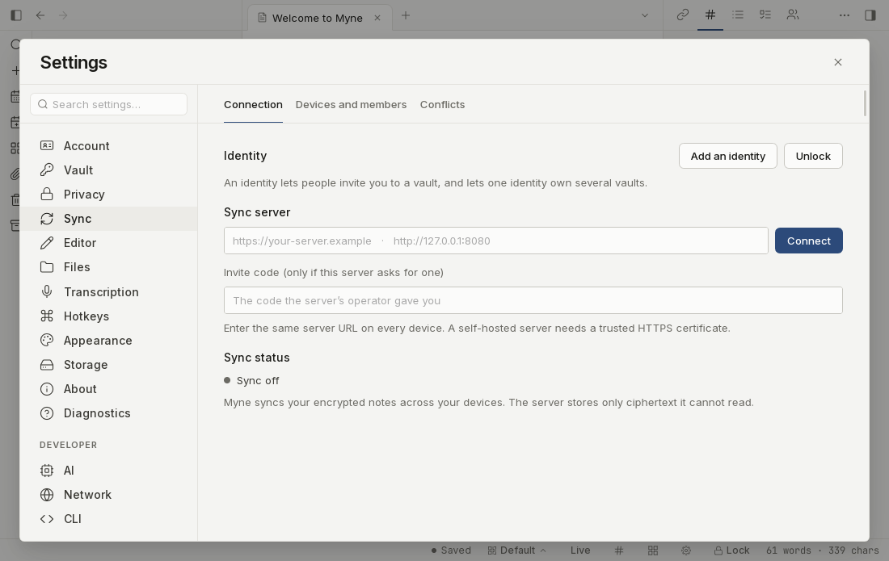

Turning on sync has four parts: pointing Myne at a server, publishing the vault you want on it, accepting the beta terms on this device, and connecting the device to your account. This page covers the first device, the one that seeds the account. Adding a second device is covered separately in [Add a device](/user-guide/sync-and-devices/add-a-device/).

## Prerequisites

- An unlocked vault.
- A sync server address: the `https://` address of the server you run yourself. Myne operates no server of its own. If you do not have one yet, [Run your own sync server](/user-guide/sync-and-devices/run-your-own-sync-server/) brings one up on a machine you control.
- The identity that owns the vault, unlocked, and registered with that server. A vault created from your identity is bound to it, and publishing needs the identity present. If the identity is not registered yet, Myne says so and points you at your identity home.
- Your account number, only if the vault still has its own. A vault created before identities existed, and a vault created in a browser, still carries a vault account number, and Myne asked you to save it once at creation. A vault created from your identity has no number of its own.

## What identifies your account

Myne identifies you by an **account number**, not an email address. Which number, and whether you ever need to type one, depends on the vault.

- **A vault created from your identity** is one binding under that identity. You do not type a number to connect a device: the joining device proves itself with the 24 words, and an existing device approves it. The server reads the person-to-vault binding when a device asks for a vault's metadata, and it authorises each request rather than handing out a standing credential.
- **A vault that still has its own account number** (created before identities existed, or created in a browser) is addressed by that number. It was shown once when you created the vault, it starts with `MY-`, and Settings does not display it again. That vault's joining device fetches the vault's encrypted key file with the number before it can authenticate, so anyone holding the number can ask the server for that file, from anywhere, with no device of yours. The file reveals nothing by itself; what it hands someone is the material to start guessing that vault's master password. Treat that number like cash: fine to type into your own devices, not something to put in a screenshot or a support thread.

Neither number is an encryption key, and neither decrypts anything on its own. Because there is no email, there is also no email-based recovery; keep your [recovery phrase](/user-guide/getting-started/your-recovery-phrase/) somewhere safe.

## Set the server

1. Open **Settings** (the gear in the bottom bar, or `⌘,` / `Ctrl ,`) and select the **Sync** panel. Its **Connection** tab, the first, holds the server address.
2. Under **Sync server**, enter the server URL. Use the `https://` address for the server you run; a local server on the same machine can use its loopback `http://` address.
3. If your server is a closed beta, it also asks for an **invite code** — the shared code the operator gave you. Enter it in the **Invite code** field under the address. An open server needs none, and the field is safe to leave empty; a server that requires a code refuses a new account without it, with a message that says so rather than a generic failure. Adding another device to an account you already have does not ask for the code again.
4. Choose **Connect**. Once connected, the button rests as a disabled **Connected**; it becomes available again as soon as you edit the address.

For an `https` server, Myne checks the server's certificate against the public certificate authorities and checks the server name, on the first connection and every one after it. There is nothing for you to set up and no fingerprint to compare. Every `https` server is checked the same way. A loopback `http` server has no TLS, so there is no certificate to check. [Server certificates](/user-guide/sync-and-devices/server-certificates/) covers what the check does and does not prove.

Enter the **same** server URL on every device you want to sync.

## Publish the vault

Setting a server does not put a vault on it. A vault you created stays device-local until you publish it, and publishing is an explicit act, so you know when a vault stops being yours alone.

Open **Settings → Sync → Devices and members**. The **Publish to your server** row says which state the vault is in: it exists only on this device, or it is published and your other devices can reach it. Choose **Publish this vault**; Myne binds the vault to your identity on the server, which is also what lets a second device find it. Publishing is idempotent, so a retry after a failure is safe, and a failure leaves the vault unchanged on this device.

A vault that already belongs to a different identity is refused rather than published over, and a shared vault can only be published by its owner.

## The server's certificate is checked automatically

A certificate has a lifetime, so it is renewed on a schedule. A renewed certificate with a valid replacement is simply a valid certificate, and sync continues; there is no "certificate changed" state to clear and nothing for you to re-enter. If a server presents a certificate that fails the check, sync stops with a clear failure rather than connecting anyway. The remedy there is about the server, not a fingerprint you paste: check the address and that the certificate is valid. [Server certificates](/user-guide/sync-and-devices/server-certificates/) covers what the check does and does not prove.

## In a browser

The browser client does not have these steps. It syncs with one server, fixed when the deployment was built, so **Sync server** shows that address read-only, with no field to edit and no **Connect** button: "This client syncs with one server, set when it was deployed. It cannot be changed from here: the page is only allowed to talk to this one address."

There is no fingerprint to compare there either, and Myne does not do the certificate check itself. A page cannot read a server's certificate, so the panel names what does the checking instead: "Server certificate verified by this client's trust store." The check is real, but it is your browser's rather than Myne's.

## Accept the beta terms

Setting a server does not start any syncing. Under **Add a device**, Myne puts a **Review what sync means** button where the enrolment form would be, and does not render the form until you accept. Pressing it opens a dialog headed **Before you turn on sync**, which states four things:

- **What this is.** Sync stores your notes on a server you choose. They leave this device encrypted and stay that way there: the server holds ciphertext and no key, so it cannot read them, and neither can Myne, which runs no server for you. Software this young still breaks, and a bug can lose data.
- **If you lose both secrets.** If you lose your master password and your recovery phrase, your notes cannot be recovered — not by you and not by us. There is no reset, because a reset would mean Myne held a key to your notes.
- **If the server goes away.** Your notes live on your devices, so a server going away is not data loss: each device holds a complete vault on its own. You lose sync until you point it at another server and push again, and the only copy that goes is the one on the server.
- **What the server's operator can see.** Whoever runs that server can refuse to serve you, keep a copy of something you deleted until their own retention window passes, and see that an account synced, when, and roughly how much. None of that lets them read a note, because to them a note is ciphertext.

The dialog carries all four clauses itself. There is no separate terms page behind a link; the privacy policy stays one link away in **Settings → About**.

Choose **I understand, turn on sync** to accept, or **Cancel** to close the dialog and leave the gate standing. Every device you add later is asked the same thing on its own screen: the acceptance is recorded on the device in front of you and is never carried across by sync.

## The first device

The first device on an account is the one you are setting up now, so there is nothing yet to approve it against: it self-approves. For a vault published from your identity, that is the device that published it, and the publishing act is what puts the vault on the server. From this point, sync status shows **Synced** when the device is up to date (see [Reading sync status](/user-guide/sync-and-devices/sync-status/)), and any further device you connect will wait for approval from a device that already has access.

## Limits

Setting a server does not weaken your at-rest protection: your notes are still encrypted with keys derived from your password, and the server stores only ciphertext (see [How sync works](/user-guide/sync-and-devices/how-sync-works/)). The certificate check confirms this device can verify the server it is talking to; it is not a guarantee about the operator, who can still see connection metadata. Sync is not a substitute for a [backup](/user-guide/safety-and-recovery/back-up-your-vault/) — it keeps devices in step, including propagating deletions, rather than preserving a fixed snapshot.

## Shortcuts

| Action | macOS | Windows / Linux |
|---|---|---|
| Open settings | ⌘, | Ctrl , |
